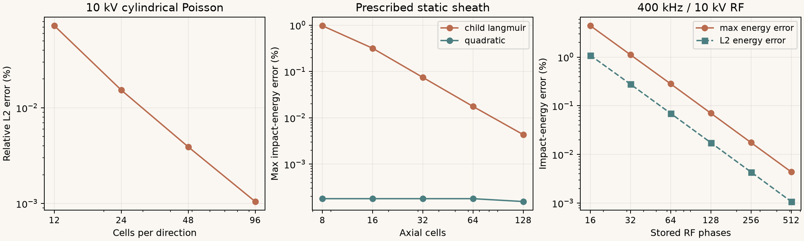
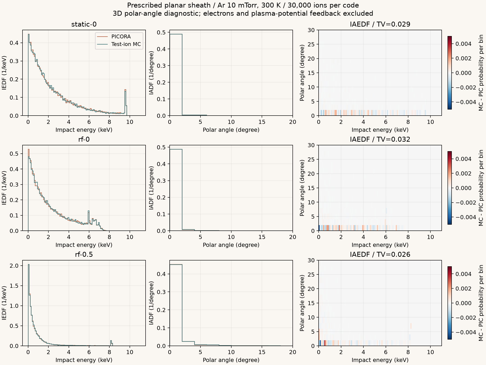
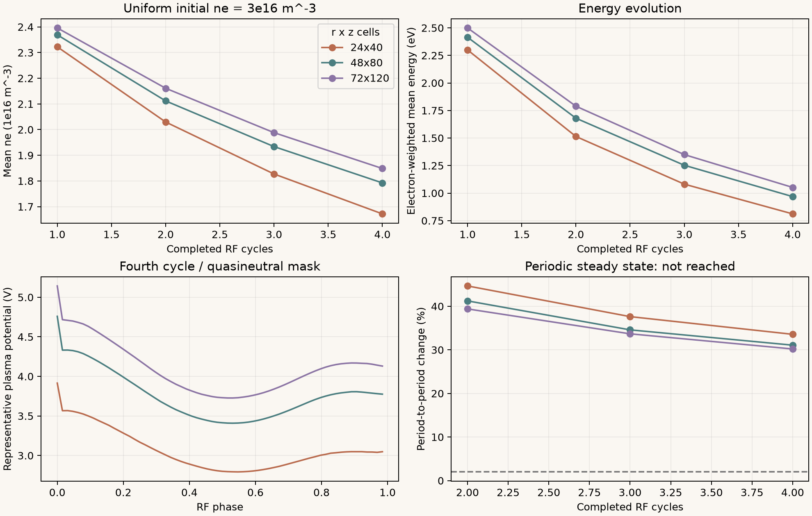

# 10 kV RFシースの検証記録 — 2026-10-14

指定した電場でのイオン輸送は、解析解とPICORA-2Dの計算に対して確認できた。
Arの実断面積を使った3万粒子×5条件では、IEDF・IADFを含むIAEDFの差が、有限粒子数から推定した統計変動の範囲に入った。
全CCPのプラズマ電位・シース場は周期・格子未収束であり、10 kVでの物理精度はまだ承認できない。
全CCPを解くPIC側にも解像度・粒子数・周期の収束確認が必要なため、今回のPIC結果をそのまま正解値として採用していない。

検証で見つかった境界電場、加速中の壁面到達、壁面直前の衝突、電子弾性損失の問題を修正した。
集計値は[metrics.json](metrics.json)、実行・照合コードは[validate_high_voltage.py](../../../scripts/validate_high_voltage.py)と
[picora_reference.py](../../../scripts/picora_reference.py)、回帰テストは[test_high_voltage.py](../../../tests/test_high_voltage.py)に保存した。
ローカルの検証はCUDAを含めて **43テスト合格**、Ruffの静的検査・書式検査も合格した。

## 条件と比較範囲

| 項目 | 今回の条件 |
|---|---|
| ガス・圧力・温度 | Ar、10 mTorr = 1.333223684 Pa、300 K |
| 駆動波形 | 接地基準で0～−10 kV、400 kHzの合成波形。負側10 kVはピーク値 |
| 装置 | 軸対称(r,z)、Wafer径300 mm、ギャップ50 mm、接地/駆動面積比5 |
| 接地面 | 上部対向電極と円筒側壁。理想円筒内径578.233 mm |
| 密度・電子エネルギー | 一様初期密度3×10¹⁶ m⁻³、初期平均電子エネルギー4.5 eV。密度1×10¹⁶、1×10¹⁷ m⁻³も確認 |
| 密度モード | 自己整合。指定密度は初期値であり、計算中に変化する |
| 表面 | Wafer・接地面ともSi、比較用に二次電子係数0・電子吸収率1 |
| 底面外周 | 電場・粒子の法線流束0の絶縁・反射境界 |
| 電子物性 | Boltzpmp 0.6.0のDC計算、EFFECTIVEから弾性成分を補正 |
| イオン衝突 | PhelpsのIsotropic / Backscat、等質量運動学、中性ガス熱運動あり |
| 計算機 | RTX 5070 Ti 16 GB、FP64、CuPy 14.2.0、cuDSS 0.8.0.10 |

実験波形・実測分布は今回の入力に含めていない。Siの係数0・1は検証条件であり、実測物性を表さない。
イオン断面積のエネルギー軸は双方で重心系に合わせた。元ファイルの軸仕様は引き続き確認が必要であり、
今回の一致はこの選択を実験的に確定するものではない。
イオン質量は双方で6.63352146325368×10⁻²⁶ kgに合わせた。
PICORAの`ion_mass_amu`は陽子質量を掛ける実装なので、入力値を換算している。

PICORAは`C:\Works\20261009_PICORA-2D`の既存ソース・uv環境で実行した。
外部のソース、プロジェクト設定、依存関係は変更せず、入力・出力・実行時キャッシュはSheath-PIC側に保存した。
参照ソースの指紋は`bf79c48157d90bb31fd8901b5c3a5bdde382851c191a742f5b9469c74f032a32`。
断面積のSHA-256、各実行のSheath-PICソース指紋、計算条件もJSON/NPZに記録している。

## 修正内容

1. **境界セルの電場**：金属面からセル中心への割線をセル中心の微分値として使っていた。
   金属面と隣接2セル中心の二次補間から微分を求め、軸上では電位の偶対称性を使うよう変更した。
   絶縁外周では面上の法線電場0とセル中心の値を区別する。
2. **到達時刻**：加速中の軌道について、直線の交点距離の割合を時間の割合として使っていた。
   Verletの局所放物線から平面・円筒への到達時間を求め、その時刻の速度でエネルギーと角度を評価する。
3. **最後の追跡刻みの衝突**：壁を横切る刻みで衝突を落としていた。
   衝突・壁面到達・体積除去の事象時刻を比較し、最初の事象まで進める。
4. **電子の弾性損失**：DCの電場入力から大きい非弾性損失等を引いた残差を弾性損失としていた。
   同じ速度格子の弾性衝突演算子で、等方成分のエネルギーモーメントを直接評価するよう変更した。
   ガスの熱運動を含み、EFFECTIVE補正はエネルギー格子の中心と面の両方で保持する。

弾性損失の評価は[Boltzpmpの衝突演算子](https://github.com/Reasonia-TK/boltzpmp/blob/main/rust/boltzpmp-core/src/operators.rs)と
[過程の構成処理](https://github.com/Reasonia-TK/boltzpmp/blob/main/rust/boltzpmp-core/src/processes.rs)に照合した。
定断面積・冷たい標的での解析式と、弾性＋非弾性の総衝突エネルギー収支を回帰テストにした。
中性ガスから電子へ流れる負の正味損失は0とし、流体側のガス熱平衡床で補う近似を残している。

場の識別子は`field_equations_version=2`、物性キャッシュは`DC-gas-heating-elastic-collision-moment-v2`とした。
以前の場・チェックポイント・物性を新しい式での継続計算へ混在させない。
保存結果の閲覧は可能。到達粒子の元の番号も新しいNPZに保存する。

## 解析解による確認

| 試験 | 最も細かい条件の結果 |
|---|---|
| 無衝突・一様電場、1/10/20 kV | 到達エネルギーと角度が解析値に浮動小数点丸めの範囲で一致 |
| 10 kV Child–Langmuir形状、軸方向128セル | 最大到達エネルギー誤差0.00435%、最大角度誤差0.000124° |
| 400 kHz・10 kVの空間一様RF電場、保存256位相 | 最大エネルギー誤差0.0175%、最大角度誤差0.00138° |
| 同RF電場、保存64位相 | 最大エネルギー誤差0.282%、最大角度誤差0.0218° |
| 真空円筒Poisson、96×96セル | Bessel級数に対する相対L2誤差0.00105% |

Child–Langmuir形状は冷たい無衝突イオンの極限を用いた指定電場の試験である。
実機の連成シース場は流体＋Poissonで計算する。
CL極限の扱いは[Benilovによる導出](https://fisica.uma.pt/Pub/Mikhail_Benilov/bib/2009a.pdf)に基づく。
Poisson比較は、境界条件が不連続になる底面・側壁の角から離れた`r<0.8R`を評価した。
級数の項数も格子に合わせて増やし、解析参照自体の打切り誤差を小さくしている。

冷たい標的の定断面積Backscatでは無衝突生存率`exp(−τ)`とエネルギーCDFを確認した。
等質量等方散乱ではエネルギー・運動量保存と`E/E0=cos²θ`の結合関係を確認した。
軸対称調和電場の3次元軌道、加速中の円筒到達、壁面直前の衝突にも独立した解析試験を追加した。



## PICORAとのイオン分布の照合

静的10 kVとRF注入位相0、0.25、0.5、0.75の5条件を比較した。
いずれも高さ`z=0.95H`から法線方向3 eV、横方向0/10/100 eVを同数注入し、
実際のAr断面積と300 Kの中性ガスを用いた。各コード3万粒子、全粒子が到達、コレクタ打切り・追跡時間切れは0。

PIC側は電子を除去し、試験イオンの密度を1 m⁻³として空間電荷を十分小さくした平面系を解く。
粒子の付与、Poisson、push、MCCはPICORAの実装で実行する。指定電場に対する粒子輸送を検証する条件である。
PICの時間刻みは0.1 ns、駆動波形は512点。
MC側の精細条件は保存256位相・基準4096刻み/周期、セル通過係数0.125、衝突ハザード0.025。

PICORAの標準角度は符号付きの断面内角度であり、MCの3次元極角と定義が異なる。
今回の実行ではコレクタの角度式だけを`acos(|vn|/|v|)`へ置換したカーネルをメモリ上でコンパイルした。
粒子運動・電荷付与・Poisson・衝突の式は同一であり、外部ソースファイルも変更していない。
元カーネルと診断用カーネルの指紋を保存した。

| 条件 | PIC平均E [eV] | MC平均E [eV] | MC−PIC [eV] | IAEDFのTV | 統計変動の99%点 |
|---|---:|---:|---:|---:|---:|
| 静的10 kV | 2381.09 | 2358.88 | −22.22 | 0.0291 | 0.0368 |
| RF、注入位相0 | 2134.20 | 2142.31 | +8.12 | 0.0325 | 0.0360 |
| RF、注入位相0.25 | 2045.94 | 2047.80 | +1.86 | 0.0322 | 0.0363 |
| RF、注入位相0.5 | 940.03 | 932.54 | −7.49 | 0.0263 | 0.0328 |
| RF、注入位相0.75 | 1769.98 | 1770.54 | +0.56 | 0.0304 | 0.0331 |

TVは共通の100 eV×2°ビンについて`0.5 Σ|p−q|`を求めた確率質量の差である。
等重み粒子の統計変動は、プールした分布から両側3万個を多項分布で300回抽出して推定した。
判定式には数値誤差として0.01の余裕を明示したが、**5条件すべて余裕を加える前の99%点以内**だった。
平均エネルギー差の最大は約0.93%。この結果は有限粒子数・指定注入条件での照合であり、全CCPの精度を意味しない。
等重みを前提とする統計判定を、可変重みの全CCP結果へ転用しないようコードで制限した。

MCの既定の追跡設定（保存64位相、セル通過係数0.25、ハザード0.05、基準128刻み/周期）も照合した。
実際の刻みはセル通過・加速の制約でも小さくなる。TVは0.0231～0.0321で、5条件とも統計変動の99%点以内だった。
IADFはWafer法線から0～90°の極角で、密度は度あたり。絶対フラックスはこの試験では評価していない。



図は静的条件とRF位相0・0.5を抜粋した。IADFは0～20°、差分図は0～30°を表示し、数値判定は全0～90°を使った。
差分図の単位はビンあたりの確率。全5条件の平均角度・標準誤差・Wasserstein距離はJSONに保存した。

## 電子物性の分割数への依存

DCの角度分割24→48で、平均電子エネルギーの相対L2差は0.156%だった。
旧方式では弾性損失の相対L2差が272%となり、大きい値の差を取る誤差が損失へ混入していた。
衝突演算子のモーメントへ変更すると、弾性損失の相対L2差は**0.00643%**、局所最大差は**0.0471%**に下がった。
後者の局所比較は、係数が精細条件の最大値の10⁻⁶を超える範囲で評価した。

E/Nの走査点36→72では、平均エネルギーに対する補間後の移動度の相対L2差1.15%、励起1.35%、電離1.12%、弾性損失0.432%だった。
励起と電離の局所最大相対差はそれぞれ297%と69.4%で、小さい反応係数の領域に大きな相対差が残る。
この値は速度係数の差であり、場や生成粒子数が同じ割合で変わるという意味ではない。
物性テーブルの反応係数の補間についても、実際の電子エネルギー域で点数収束を続ける必要がある。

## 連成場の収束

修正後の電子物性と境界電場で9条件を再計算した。各4周期、保存64位相、Newton許容値2×10⁻⁸、
基準1024刻み/周期、イオンCFL 0.4、基準密度床10⁻⁸を使用した。
刻み数は適応制御で増える。代表プラズマ電位は準中性領域の電子数重み付き平均で、
シース電圧は`Vs(t)=Vwafer(t)−Vp(t)`とした。

| 初期ne [m⁻³] | 格子 | 4周期後の平均ne [m⁻³] | 平均電子エネルギー [eV] | 周期間変化 | 場計算時間 |
|---:|---|---:|---:|---:|---:|
| 3×10¹⁶ | 24×40 | 1.672×10¹⁶ | 0.811 | 33.6% | 29.6秒 |
| 3×10¹⁶ | 48×80 | 1.792×10¹⁶ | 0.968 | 31.1% | 70.6秒 |
| 3×10¹⁶ | 72×120 | 1.849×10¹⁶ | 1.052 | 30.2% | 203.8秒 |
| 1×10¹⁶ | 24×40 | 4.939×10¹⁵ | 0.669 | 37.9% | 30.8秒 |
| 1×10¹⁷ | 24×40 | 6.014×10¹⁶ | 0.941 | 29.3% | 29.5秒 |

全9条件が終了したが、いずれも周期定常の既定基準2%を満たさなかった。
時間は場の初期化を含む。DC物性の作成・出力保存は別であり、実行中の別処理の影響も含む。

| 比較 | 電位の相対L2差 | neの相対L2差 | 生の電子エネルギー密度の相対L2差 | VpのRMS差 |
|---|---:|---:|---:|---:|
| 24×40 → 48×80 | 5.15% | 13.68% | 27.41% | 0.693 V |
| 48×80 → 72×120 | 2.41% | 5.08% | 11.43% | 0.347 V |
| 基準128 → 1024刻み/周期 | 0.0516% | 0.0706% | 0.296% | 0.0106 V |
| 基準1024 → 4096刻み/周期 | 0.0936% | 0.103% | 0.377% | 0.0127 V |
| 密度床10⁻⁸ → 10⁻¹⁰ | 0.0251% | 0.148% | 0.919% | 0.0325 V |
| 密度床10⁻⁸ → 10⁻⁶ | 0.00351% | 0.0136% | 0.114% | 0.00388 V |

相対L2差の分母は比較元の場。電位は比較元のセル中心へ補間し、密度・生のエネルギー密度は
円筒セルの重なり体積で保存的に写像して比較した。重みは円筒体積で、保存した全64位相を用いた。
Vpはそれぞれの格子で準中性領域を抽出して比較した。全領域の電位ノルムには大きい駆動電位が含まれるため、
電位の相対L2差をそのままバルクのVp誤差と解釈しない。

4周期過渡場の時間刻み・密度床への感度は、この範囲では空間格子の感度より小さかった。
空間比較の暫定基準を各場の相対L2差5%とすると、最後の格子間でも電子エネルギー密度は未達である。
5%は今回の数値検証用の暫定値であり、実機予測に求める許容誤差は別途設定する必要がある。
周期未収束の過渡場での比較なので、定常解の格子収束を確認したことにはならない。

計算中の最小Debye長は18.4～48.8 µmで、軸方向セル幅は417～1250 µm。
シース遷移層の詳細を評価するには解像度が不足する。
全条件の電子数収支の相対誤差は最大3.87×10⁻⁹、電子エネルギー収支は最大2.96×10⁻¹¹だった。
保存則は閉じているが、平均電子エネルギーの低下と周期・格子依存は残る。
弾性損失の修正だけでこの問題は解消していないため、連成場の精度は未確認とする。



## 全CCPのPIC参照計算

初期Debye長は約74.3 µm、採用した時間刻みは約10.23 psで`ωpe Δt≈0.1`。
[TurnerらのPICベンチマーク](https://arxiv.org/pdf/1211.5246)で用いられる精度の目安`λD/Δx≥2`に対して、
約1 mm・0.5 mmの格子はいずれも粗い。PICORAが計算を完了できることと、参照解として収束していることは別途評価した。

| 予備計算 | 初期マクロ粒子/種 | 到達周期数 | 最後の記録の最大電位 | 評価 |
|---|---:|---:|---:|---|
| 320×52、約1 mm、5000刻み | 10万 | 0.0205 | 854 V | Debye長未解像 |
| 640×104、約0.5 mm、5000刻み | 40万 | 0.0205 | 171 V | 依然未解像、格子変更で大きく変化 |
| 320×52、時間刻み1/4、20000刻み | 10万 | 0.0205 | 1043 V | 時間細分化だけでは差を解消できず |
| 6144×1024、約50 µm、500刻み | 1000万 | 0.00205 | 26.6 V | 短時間の予備試験、周期・粒子数収束未確認 |

粗い320×52格子の4周期試行は、約0.06周期で粒子数が急増しGPUメモリ不足となった。
最後の保存診断では最大電位約199 kVだった。参照解として不採用とした。
格子加熱の可能性はあるが、今回の試験で原因を確定してはいない。
以後の実行コードには粒子数上限を設け、上限超過時は未承認の結果として保存・停止するようにした。

50 µmの試験は約630万節点で、実寸の`Δr=47.1 µm`、`Δz=48.9 µm`。
初期の`λD/Δz≈1.52`で上記の目安をまだ満たさず、電子が冷却した場合はさらに細かい解像度が必要になる。
500刻みの実行は約66秒、0.00205周期であり、負ピークの時刻に達していない。
実装のメモリ制限により位相保存は64→1へ縮小されたため、RF位相別の場の参照にも使用できない。
粒子数が同じで1刻みあたりの費用も一定と仮定した4周期の単純外挿は約30時間で、所要時間の保証ではない。

全CCPのPIC形状には、外部実装の境界指定に合わせて底面外周の反射面を100 µm下げる差がある。
面積比は5.00257。形状差の感度、粒子数・格子・位相保存・周期定常の確認が済むまで、全CCPの正解値とはしない。
実行状況、メモリ不足、格子寸法、位相保存の縮小を集計JSONにも保持した。

## 再現手順

既存結果への上書きは禁止する。以下は新しい保存先を指定する例で、PICORAの既存uv環境が利用できることを前提とする。
各スイートの元NPZ・診断・進捗は指定フォルダーに保存する。大容量データはGitの対象外とし、図と集計JSONをリポジトリに保持する。

```powershell
cd C:\Works\20261013_Sheath-PIC
$env:UV_CACHE_DIR = Join-Path (Get-Location) '.uv-cache'
$env:PYTHONIOENCODING = 'utf-8'
$env:CUPY_CACHE_DIR = Join-Path (Get-Location) '.cache/cupy'
$env:NUMBA_CACHE_DIR = Join-Path (Get-Location) '.cache/numba-picora'
$taskCudaTemp = Join-Path (Get-Location) '.cache/tmp'
New-Item -ItemType Directory -Path $taskCudaTemp -Force | Out-Null
$env:TEMP = $taskCudaTemp
$env:TMP = $taskCudaTemp
$taskRunRoot = 'artifacts/verification-20261014-repeat'

uv run --locked --extra cuda python scripts/validate_high_voltage.py --suite analytic --output "$taskRunRoot/analytic"
uv run --locked --extra cuda python scripts/validate_high_voltage.py --suite transport --output "$taskRunRoot/final-transport"
uv run --locked --extra cuda python scripts/validate_high_voltage.py --suite fields --backend cuda --output "$taskRunRoot/final-fields"
uv run --locked --extra cuda python scripts/validate_high_voltage.py --suite picora --picora C:/Works/20261009_PICORA-2D --output "$taskRunRoot/picora-comparison"
uv run --locked --extra cuda python scripts/validate_high_voltage.py --suite mc-resolution --references "$taskRunRoot/picora-comparison" --output "$taskRunRoot/mc-resolution"
uv run --locked --extra cuda python scripts/plot_high_voltage_validation.py --data $taskRunRoot --output "$taskRunRoot/figures"
```

全CCPの約50 µm予備試験は別途実行できる。既定の粒子上限を明示的に増やした今回の試験条件である。

```powershell
$env:PYTHONDONTWRITEBYTECODE = '1'
uv run --project C:/Works/20261009_PICORA-2D/backend --no-sync --offline python -B scripts/picora_reference.py --picora C:/Works/20261009_PICORA-2D --output "$taskRunRoot/picora-fine-pilot" --mesh-size 0.00005 --macros 10000000 --particle-budget 24000000 --steps 500 --omit-final-particles
```

原データは今回の作業環境の`artifacts/high-voltage/`に保持した。
`analytic/`、`picora-comparison/`、`mc-resolution/`、修正後の`final-fields/`・`final-transport/`が今回の判定対象である。
修正前の`fields/`、`fields-conservative/`、`transport/`、`pre-fix-pilot/`は経過記録で、新しい結果と混在させない。
各実行時のソース指紋を別々に保存し、後の書式変更を含むコードとの差も追跡できるようにした。

## 次に必要な検証

まずPIC参照側の格子・粒子数・位相保存の費用を抑える構成を整え、周期定常な全CCPの参照を作る。
候補には領域を限定した参照試験や、[陰的・エネルギー保存PIC](https://arxiv.org/abs/2306.01581)がある。
採用前には新しいPIC方式自体の収束検証が必要になる。

その参照に対してプラズマ電位、シース境界、電子エネルギー、流体イオン密度、半径別の分布を照合する。
現行流体場は電子にDC物性＋Maxwellモーメントを使う。
低圧での非局所電子・二次電子の寄与は[2次元RF流体モデルの検討](https://pmc.ncbi.nlm.nih.gov/articles/PMC4887236/)にも示されており、
今回の冷却・密度減少の原因候補として調べる必要がある。原因がモデル近似か数値誤差かは、まだ切り分けが済んでいない。
任意密度分布、密度維持モード、二次電子係数を変えた条件は今回のPIC照合の対象外である。
